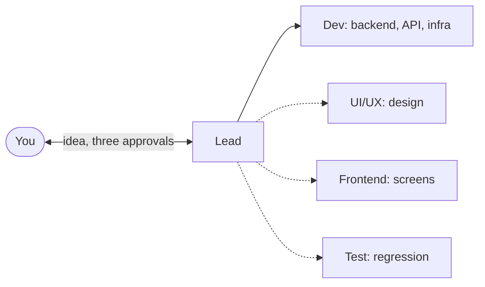

# Crewbook Build for Claude

Build with Claude Code sessions that share a plan, clear responsibilities and a review process.

A playbook and starter kit for people with a technology background who know how a software project is made (requirements, design, build, test, release) and want Claude Code to run it, whether or not they write code themselves. One session, the Lead, turns requirements into a plan and tasks, and runs the other roles (a Dev, and Frontend, UI/UX and Test when the project needs them), each in its own worktree with its own rules. Work moves through issues, reviewed pull requests, CI, a `staging` environment and tagged releases. You decide three times: the plan, each milestone and each release. You stay responsible for the decisions: what is built, the trade-offs, and what ships.

[Set up your first project](HOW-TO-RUN.md). You need Claude Code, Git, Node.js 20+, Docker with Compose v2 and the GitHub CLI.

```bash
git clone https://github.com/liquizzz/crewbook-build.git
```

```bash
node crewbook-build/kit/init.mjs
```

Three questions (Enter takes each suggestion), then open the Lead's worktree in Claude Code and type `/cb-setup`.

## How it works



1. You describe it: in your own words, a document, a product you want to beat, an old system to replace. The Lead asks at most three questions at a time, each with a suggested answer.
2. You approve the plan: stories, a function tree of modules and screens, three architectures with their cost (one recommended), the environments, the first milestone. One page.
3. The team builds. The Lead writes each task with its risk level and the cheapest model that can do it. Each role builds test-first, reviews its own diff in a fresh context, and opens a PR. The Lead merges up to the level you allow.
4. You try the milestone on `staging`, with 3 to 5 things to try, what a wrong result looks like, and links to the evidence. "All pass", or what failed.
5. You approve the release: a version tag, a Docker image, a handover for the client. `node scripts/run.mjs v0.1.0` runs it anywhere.

## What you get

| | |
|---|---|
| A ready project in one command | Branches, the Lead's worktree, a GitHub repo with labels and a kanban board, CI (on GitHub, or on your machine for free with a private repo), Docker, the plugins, and a `START-HERE.md` with every next step |
| A team split by layer | The Lead and the Dev always; UI/UX, Frontend and Test when the project needs them, added later with `/cb-add-role`. Each role in its own worktree, on its own branch, inside its own folders |
| A guard on every command | One hook checks every command, read and edit in every session and subagent: only your own branch, only the Lead merges, no skipped checks, no reading database backups, no reading `.env` files or dumping the environment, production only by you |
| Checks sized to the risk | Four change levels, from a text fix (CI and a look) to core code (tests by reach, a code review and a security review). Reviews and CI are tied to the commit and reused while still valid |
| Lower cost, measured | A model per task, from Haiku to Opus, climbing one step only when stuck; sessions cleared when a phase ends; one database server per machine for every project; a weekly report of where the tokens went |
| Records a client can follow | Change requests with the client's approval and price, decisions with the options rejected, a requirements document kept current, a handover for each release, and the chain from any behaviour back to the request that caused it |
| Updates that keep your work | `/cb-update` brings the newest kit into a running project through a PR you approve; your files, rules and decisions stay |

## The book

| | Chapter | Use it to |
|---|---|---|
| 0 | [Introduction](docs/book/00-introduction.md) | See the idea in one minute and the seven-step quick start |
| 1 | [Setup](docs/book/01-setup.md) | Install the tools and create the project |
| 2 | [The team](docs/book/02-the-team.md) | Know who does what, how work moves and what the guard blocks |
| 3 | [The plan](docs/book/03-the-plan.md) | Answer five questions and approve the plan |
| 4 | [The delivery loop](docs/book/04-delivery-loop.md) | Let the team build; ask for a change; report a bug |
| 5 | [Milestones and releases](docs/book/05-releases.md) | Try a milestone, approve a release, deploy, roll back |
| 6 | [Continuity](docs/book/06-continuity.md) | Restart, recover a stalled session, update the kit |
| 7 | [Products with screens](docs/book/07-products-with-screens.md) | Pick the look and feel; design ahead of the code |
| 8 | [Small teams](docs/book/08-small-teams.md) | Run with fewer roles; add one later |
| 9 | [Token budget](docs/book/09-token-budget.md) | See where the tokens go and keep them down |
| A-E | [Templates](docs/book/appendix-a-templates.md) · [Kit](docs/book/appendix-b-kit.md) · [FAQ](docs/book/appendix-c-faq.md) · [Checklist](docs/book/appendix-d-checklist.md) · [Standards](docs/book/appendix-e-standards.md) | Look something up |

## FAQ

**What do I need to know?**
How a software project moves from requirements to a release, and what a requirement, an architecture choice, a test, a pull request and a staging environment are for. You do not need to write code: the sessions write the code, the tests and the documents, and each approval lists what to try, what a wrong result looks like and what the tests and reviews already cover. Reading code helps when you want to check a risky change yourself.

**How is this different from vibe coding?**
Vibe coding ships whatever the last prompt produced. Here every change has a requirement, a risk level, tests sized to it and a review tied to its commit, and nothing is released before you have tried it on `staging`. The tenth feature is as solid as the first.

**How is it different from agent teams, BMAD-METHOD or spec-kit?**
All of them start from a spec. Crewbook carries on to the end of delivery: each role in its own session and worktree, a guard that keeps it in its lane, models chosen per task, CI, a staging environment, versioned Docker images, change requests and rollbacks, and three decisions for you. For a quick prototype spec-kit is faster. Crewbook is for software you will hand over or keep running.

**What stack does it use?**
Any. The Lead proposes three architectures with their cost and recommends one; a platform you or your client require is a constraint.

**What does it cost?**
A Claude subscription with Claude Code, and GitHub (the free plan is enough). [Chapter 9](docs/book/09-token-budget.md) shows the numbers and how the kit keeps them down.

## Repository

| Path | Contents |
|---|---|
| [HOW-TO-RUN.md](HOW-TO-RUN.md) | From clone to your first project |
| [docs/book/](docs/book/) | The book |
| [templates/](templates/) | The documents the sessions fill in |
| [kit/](kit/) | What `kit/init.mjs` installs into a project |
| [docs/spec/](docs/spec/) | The playbook's own requirements and decision log |
| [docs/ai-log.md](docs/ai-log.md) | How this playbook itself was built with AI |
| [docs/assets/](docs/assets/) | The social preview image and its source |

## License

[](LICENSE) [](kit/LICENSE)

| Part | License |
|---|---|
| Docs and templates (`README.md`, `docs/`, `templates/`) | [Creative Commons Attribution 4.0 International](LICENSE) |
| Kit (`kit/`: hooks, scripts, workflows, settings, role files) | [MIT](kit/LICENSE) |

You may use, adapt and share both, including commercially. Please give credit: "Crewbook by Hai Nguyen (github.com/liquizzz/crewbook-build)". Code files carry an `SPDX-License-Identifier: MIT` line; keep it when you copy them.
