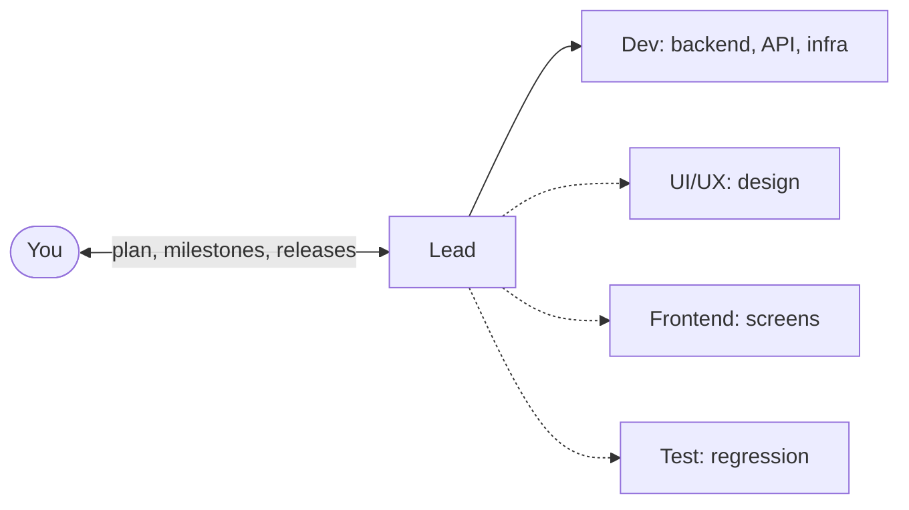

# Crewbook Build for Claude

Build with Claude Code. Lead the team.

Crewbook is an open-source Claude Code workflow kit for developers building products and client software. Give your project a Lead to turn the idea into a plan, a Dev to build the application, and Frontend, UI/UX and Test sessions when you need them. Move from the first brief through reviewed PRs to a version you can try on staging and hand over to a client.

Talk to the Lead, review the plan and try the product as it grows. Choose how much the team handles on its own. The three checkpoints are simple: approve the plan, accept each milestone, approve each release.

Models chosen per task and reusable checks also help keep usage under control as the project grows.

[Start your first Crewbook project](HOW-TO-RUN.md). With Claude Code, Git, Node.js 20+, Docker with Compose v2 and the GitHub CLI installed:

```bash
git clone https://github.com/liquizzz/crewbook-build.git
```

```bash
node crewbook-build/kit/init.mjs
```

Answer three setup questions, open the Lead's worktree and type `/cb-setup`. The generated `START-HERE.md` guides you from there.

## How the Claude Code workflow works



1. You describe it: in your own words, a document, a product you want to beat, an old system to replace. The Lead asks at most three questions at a time, each with a suggested answer.
2. You approve the plan: a one-page overview of the product, recommended architecture, environments and first milestone, with the stories and technical detail behind it.
3. The team builds. The Lead assigns tasks and models by risk. Implementers open PRs with the checks and reviews each change needs; the Lead merges up to the level you allow.
4. You try the milestone on `staging`, with 3 to 5 things to try, what a wrong result looks like, and links to the evidence. "All pass", or what failed.
5. You approve the release: a version tag, Docker images and a handover for the client. `node scripts/run.mjs v0.1.0` runs that version on your machine.

## What you get

| | |
|---|---|
| A project ready for the team | One initializer sets up the kit, branches, the Lead's worktree and `START-HERE.md`, with GitHub repo, label and board setup when you choose it |
| A team split by layer | The Lead and the Dev always; UI/UX, Frontend and Test when the project needs them, added later with `/cb-add-role`. Each role in its own worktree, on its own branch, inside its own folders |
| Clear boundaries for the work | Role instructions and hooks check branch pushes, file ownership and sensitive operations, so sessions have a defined place to work and a path to hand changes over |
| Checks sized to the risk | Four change levels, from a text fix (CI and a look) to core code (tests by reach, a code review and a security review). Reviews and CI are tied to the commit and reused while still valid |
| Records a client can follow | Change requests with the client's approval and price, decisions with the options rejected, a requirements document kept current, a handover for each release, and the chain from any behaviour back to the request that caused it |
| A workflow you can keep using | Issues and hand-offs let a fresh session pick up the work; `/cb-update` prepares supported kit updates as a PR for you to review |

## Read the guide

| | Chapter | Use it to |
|---|---|---|
| 0 | [Meet Crewbook](docs/book/00-introduction.md) | Understand the team and choose where to start |
| 1 | [Start your first project](docs/book/01-setup.md) | Prepare your machine and open the Lead session |
| 2 | [Plan your product](docs/book/02-plan-your-product.md) | Choose the roles, shape the requirements and approve the plan |
| 3 | [Build and review](docs/book/03-build-and-review.md) | Deliver tasks, review PRs, request changes and report bugs |
| 4 | [Try, release and deploy](docs/book/04-try-release-and-deploy.md) | Accept a milestone and deliver a version your client can run |
| 5 | [Continue and maintain](docs/book/05-continue-and-maintain.md) | Resume work, recover a session, move machines and update the kit |
| 6 | [Design and frontend](docs/book/06-design-and-frontend.md) | Choose the look and feel and turn designs into screens |
| 7 | [Configure your team](docs/book/07-configure-your-team.md) | Adjust autonomy and add or pause role sessions |

Read chapters 1 to 5 for the main delivery path. Use chapter 6 when your product has screens, and chapter 7 when you want to change how the team works.

### Reference

| Appendix | Look up |
|---|---|
| [A. Quick reference](docs/book/appendix-a-quick-reference.md) | Commands, common tasks and Crewbook terms |
| [B. Kit and configuration](docs/book/appendix-b-kit.md) | Installed files, scripts, models, environments and plugins |
| [C. Troubleshooting](docs/book/appendix-c-faq.md) | Setup problems and questions during delivery |
| [D. Templates and checklist](docs/book/appendix-d-templates-and-checklist.md) | What to check and which document to use |
| [E. Standards map](docs/book/appendix-e-standards.md) | The practices behind the workflow |

## FAQ

**Who is it for?**
Developers who already use Claude Code and want a repeatable way to deliver a product, an internal tool or a client project. Bring your programming experience; the kit gives your sessions the roles, records and delivery workflow to work together.

**How is this different from vibe coding?**
Crewbook keeps the request, implementation and review connected as the project grows. Each task has a risk level and checks to match; each milestone gets a staging version you can try before release. You can follow a change from the original request to the PR that delivered it.

**How does Crewbook organize multiple Claude Code sessions?**
Each role works in a separate Git worktree with its own branch and assigned folders. The Lead coordinates tasks, reviews PRs and merges the work into `dev`. You choose the merge and hand-off settings. See [build and review](docs/book/03-build-and-review.md) for the delivery loop and [team configuration](docs/book/07-configure-your-team.md) for the controls.

**What stack does it use?**
Any. The Lead proposes three architectures with their cost and recommends one; a platform you or your client require is a constraint.


## Repository

| Path | Contents |
|---|---|
| [HOW-TO-RUN.md](HOW-TO-RUN.md) | From clone to your first project |
| [docs/book/](docs/book/) | The book |
| [templates/](templates/) | The documents the sessions fill in |
| [kit/](kit/) | What `kit/init.mjs` installs into a project |
| [docs/spec/](docs/spec/) | Crewbook's requirements and decision log |
| [docs/ai-log.md](docs/ai-log.md) | How Crewbook was built with AI |
| [docs/assets/](docs/assets/) | The social preview image and its source |

## License

[](LICENSE) [](kit/LICENSE)

| Part | License |
|---|---|
| Docs and templates (`README.md`, `docs/`, `templates/`) | [Creative Commons Attribution 4.0 International](LICENSE) |
| Kit (`kit/`: hooks, scripts, workflows, settings, role files) | [MIT](kit/LICENSE) |

You may use, adapt and share both, including commercially. Please give credit: "Crewbook by Hai Nguyen (github.com/liquizzz/crewbook-build)". Code files carry an `SPDX-License-Identifier: MIT` line; keep it when you copy them.
