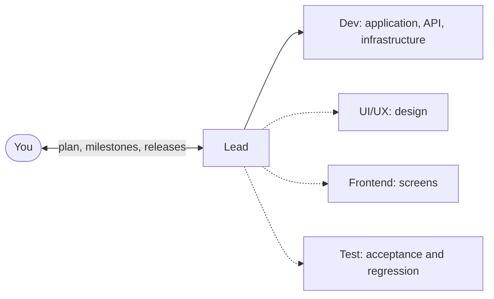

# Chapter 0: Meet Crewbook Build for Claude

← [Back: README](../../README.md) · [Contents](../../README.md#read-the-guide) · [Next: Chapter 1: Start your first project](01-setup.md) →

**Purpose:** give your Claude Code sessions a delivery workflow, from the first product idea to a release you can hand over. A Lead coordinates the work; implementers deliver tasks through reviewed PRs; you try each milestone on staging before it ships.

## A team for the project you will keep developing

This book is for developers who already use Claude Code to create and debug software. Bring your programming experience and your judgement about the product. The kit supplies role instructions, commands, templates and hooks so your sessions can work from the same plan and leave a record the next session can use.

For a client project, that record connects requests and their scope to the changes delivered. For an internal tool or API, you can start with a Lead and Dev. A product with substantial screens can add UI/UX and Frontend, with design ahead of implementation and an agreed API contract between layers. Test can concentrate on acceptance criteria and regression.

## How Claude Code roles work together

Lead and Dev are always present. The dotted roles are selected by default during setup; leave out what the project does not need. Each role works in its own Git worktree with its own branch and assigned paths. Reports and questions return to the Lead, giving you one conversation to follow.

The Lead turns your idea into requirements and a plan, assigns tasks, and checks the PRs before merging within the level you allow. Task risk determines the checks and reviews. Models chosen per task and reusable checks help keep usage under control as the project grows.

## Your three approval checkpoints

Approve the plan once the scope, architecture and first milestone are clear. When that milestone is ready, try it on staging and accept it or report what failed. Then approve the release, with its version tag and handover.

You can inspect the code and evidence, request changes and adjust how much the Lead handles on its own. Money, accounts, secrets, production, deleting data and changes to a client's scope, date or price still wait for you. Production deployment remains yours; the team prepares the images and commands.

## Start your first project

Follow [chapter 1](01-setup.md) to install the prerequisites, create a project and open its Lead. Then [plan your product](02-plan-your-product.md), [build and review](03-build-and-review.md), and [try, release and deploy](04-try-release-and-deploy.md).

The later chapters cover continuing work across sessions, frontend design and growing the team. Use the [quick reference](appendix-a-quick-reference.md) for commands and the [project checklist](appendix-d-templates-and-checklist.md) to check a project's progress. The [contents](../../README.md#read-the-guide) groups the book by when you need each part.

---

← [Back: README](../../README.md) · [Contents](../../README.md#read-the-guide) · [Next: Chapter 1: Start your first project](01-setup.md) →
