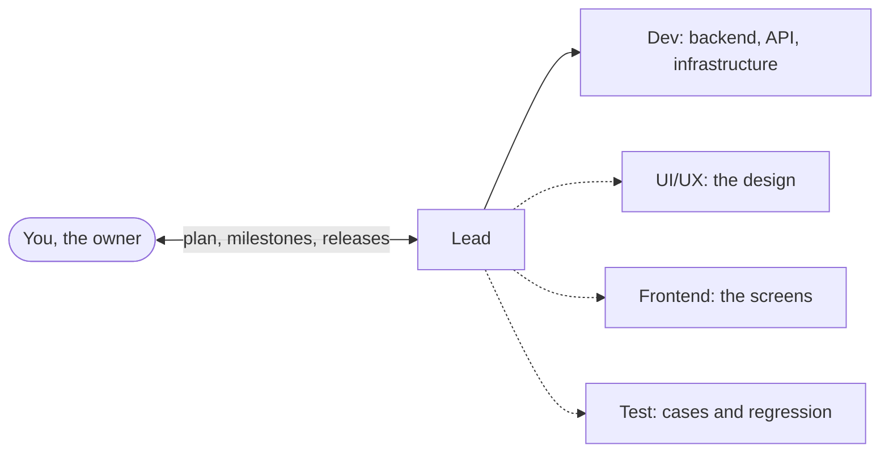

# Chapter 0: Crewbook Build for Claude

**Purpose:** take a project from the first idea to a version you can try, release and hand over, with a team of Claude Code sessions.

← [Back: README](../../README.md) · [Contents](../../README.md#the-book) · [Next: Chapter 1: Setup](01-setup.md) →

## The idea in one minute

You already know how to build with Claude Code. Crewbook gives your sessions a way to work together as the project grows: a Lead to plan and coordinate, a Dev for the application, and UI/UX, Frontend and Test when you need them. Each role has its own worktree, tasks and hand-offs.

Describe the product to the Lead and approve the plan. The Lead assigns the work, follows the PRs and brings each milestone to staging for you to try. When you accept it, approve a release with its version tag and handover. These are the workflow's three checkpoints: the plan, the milestone and the release.

## Who this book is for

The kit is for developers who already use Claude Code to create and debug projects. Familiarity with Git, PRs and tests lets you start with the workflow straight away.

| What you are building | What Crewbook adds |
|---|---|
| A product you will keep developing | Requirements and decisions the next session can pick up, with changes delivered through reviewed PRs |
| A client project | A plan to approve, changes with their scope and price, staging demos and a release handover |
| An application with a substantial UI | Dev and Frontend working from an agreed API contract, with UI/UX designing ahead of implementation |
| An internal tool or API | A smaller team using the same planning, review and release workflow |

[How to run](../../HOW-TO-RUN.md) covers the tools and installation. Task-specific models and reusable checks help keep usage under control while the team builds.

## What stays in your hands

You set the product direction and choose how much the team handles on its own. The Lead brings you a recommendation with the work behind it: a plan, a working milestone or a release summary. You can inspect the code and evidence, request changes, and set the level of PRs the Lead may merge.

Production hosting and credentials stay under your control. The team prepares the images, deployment commands and handover; you approve the release and run production deployment. See [chapter 5](05-releases.md) when you are ready to ship.

## Quick start: from idea to a running version

| # | Where | You type | You get |
|---|---|---|---|
| 1 | Terminal | `node crewbook-build/kit/init.mjs` | The kit, branches and `START-HERE.md`, with GitHub repo and board setup when selected ([chapter 1](01-setup.md)) |
| 2 | Lead | `/cb-setup`, then your idea in your own words | Five short questions, each with a suggestion; then one page with the plan to approve ([chapter 3](03-the-plan.md)) |
| 3 | Lead | `/cb-progress` to follow the work | The Lead coordinates the first milestone; the sessions build and open PRs, and the Lead merges within your chosen level ([chapter 4](04-delivery-loop.md)) |
| 4 | Lead | `/cb-release demo` | The milestone on `staging`, a link and 3 to 5 things to try. Say "All pass" or what failed ([chapter 5](05-releases.md)) |
| 5 | Lead | `/cb-release` | The handover, your release approval, a version tag and its Docker image |
| 6 | Terminal | `node scripts/run.mjs v0.1.0` | That version running on your machine |
| 7 | Lead | `/cb-change <one small feature>` | The change written down, built and released as the next version |

## The model

The Lead and the Dev are always there. The dotted roles are ticked by default at setup; you leave out what the project does not need, and add one later with `/cb-add-role` ([chapter 8](08-small-teams.md)). Each role is its own Claude Code session in its own git worktree (a second folder of the same project), with a role file and a guard that blocks what the role must not do. Every report from a role goes to the Lead, and the Lead is the only one that talks to you.

## Principles

1. The AI understands, you decide. Say what you want the way you would to a person. The session works out what you mean, fills the gaps, proposes with a recommendation and asks at most three questions at once.
2. You approve three times: the plan, each milestone, each release, plus anything that touches money, accounts, secrets, production, deleting data or a client's scope, date or price.
3. Everything is written down as soon as it is decided: stories, requirements, decisions and changes all live in the repo, so a new session, a new developer or the client can follow them.
4. Risk sets the effort: each task gets a change level (L0 to L3). The level sets the tests, the reviews and who approves.
5. Each task starts on the model its level needs, and moves up one step only when it is stuck ([models per task](02-the-team.md#4-models-per-task)).
6. Keep credentials and database administration in the owner-run scripts. Role hooks check sensitive file access and operations as the sessions work.

## How each task is written in this book

> **What it does:** why you would do it.
>
> **Ask:** the session to talk to and what to type.
>
> **Claude asks you:** what the session may ask: at most three questions together, each with its suggested answer.
>
> **Claude does:** what the session then does on its own.
>
> **You check:** what you read, try or decide.
>
> **Claude asks before:** actions that wait for your OK.

Three phrases steer any session: "suggest" (propose ideas), "later" (park it under Open decisions until a step needs it) and "you decide" (take the recommendation and list the calls you made).

## Chapters

| Chapter | Use it to |
|---|---|
| [1 Setup](01-setup.md) | Install the tools and create the project |
| [2 The team](02-the-team.md) | Know who does what, how work moves and what the guard blocks |
| [3 The plan](03-the-plan.md) | Answer five questions and approve the plan |
| [4 The delivery loop](04-delivery-loop.md) | Let the team build; ask for changes; report a bug |
| [5 Milestones and releases](05-releases.md) | Try a milestone, approve a release, deploy, roll back |
| [6 Continuity](06-continuity.md) | Restart, recover a stalled session, update the kit |
| [7 Products with screens](07-products-with-screens.md) | Pick the look and feel; design ahead of the code |
| [8 Small teams](08-small-teams.md) | Run with fewer roles; add one later |
| Appendices | [A Templates](appendix-a-templates.md) · [B Kit](appendix-b-kit.md) · [C FAQ](appendix-c-faq.md) · [D Checklist](appendix-d-checklist.md) · [E Standards](appendix-e-standards.md) |

## Words

| Term | Meaning |
|---|---|
| Owner | You: the person who decides scope, priorities and releases |
| Session | One Claude Code conversation playing one role |
| Lead | Your one contact: the plan, the tasks, every change, the merges, the milestone and the release |
| Role | Lead, Dev, UI/UX, Frontend or Test; the project's roles are chosen at setup |
| Worktree | A separate checkout of the same Git repo for each role, with its own branch and working files |
| Branch | A line of work: `role/<role>` per role, `dev` (work in progress), `staging` (what you try), `main` (released) |
| Issue | A GitHub item for one piece of work: a task, a CR, a defect, a decision |
| PR (pull request) | A request to merge a branch into another; it shows the change, its checks and its reviews |
| CI | The automatic checks on every change: lint, types, tests, build; on GitHub or on your machine |
| Change level | The risk of a task: L0 display, L1 a setting or small logic, L2 module logic, L3 core (shared code, sign-in, money, personal data, the schema) |
| CR (change request) | A change to what the client gets, with who asked, its impact and the client's approval |
| ADR / DEC | A recorded technical / business decision, with the options rejected and why |
| SRS | The requirements document, always current, with numbered requirements (`FR-xxx`, `NFR-xxx`) |
| Function tree | The product as modules, then screens or functions, then their main actions |
| Milestone | The next version, a few stories built and tried together |
| Staging | The test copy of the product, with its own database, where you try each milestone |
| Regression | The important scenarios of the whole product, run again on `staging` before a release |
| Docker image | A packaged, runnable part of the product, tagged with its version, such as `api:v0.1.0` |
| Model ladder | Haiku low, Sonnet medium, Sonnet high, Opus medium, Opus high: a task climbs one step when it is stuck |
| Token | The unit Claude usage is measured and paid in |

---

← [Back: README](../../README.md) · [Contents](../../README.md#the-book) · [Next: Chapter 1: Setup](01-setup.md) →
