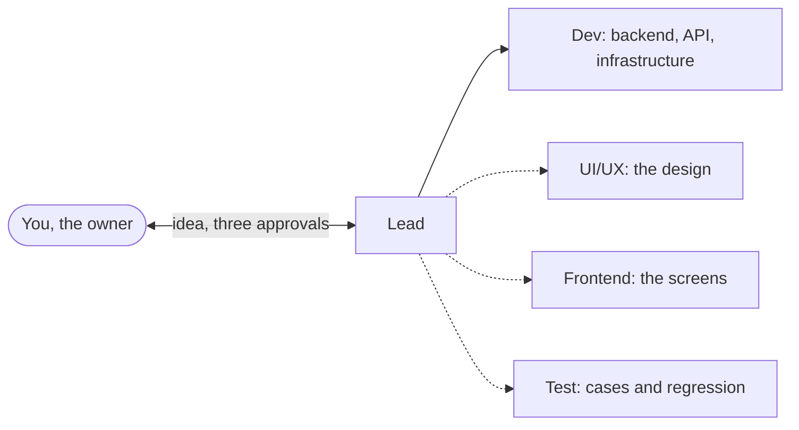

# Chapter 0: Introduction

**Purpose:** build real software with a team of Claude Code sessions, where you make three decisions and the team does the rest, with every step written down so it can be checked, changed or handed over.

## The idea in one minute

You talk to one session, the Lead. You tell it what you want in your own words. It turns that into a plan: who uses the product, what each screen does, how it is built, where it runs. You approve the plan once. From then on the Lead runs a small team of sessions (a Dev for the backend, a Frontend for the screens, a UI/UX designer and a tester when the project needs them), each in its own folder with its own rules. They build, test, review and merge. When a milestone is ready, you try it on a test copy of the product and say "All pass" or what is wrong. When you are happy, you approve the release.

Your part is three decisions: the plan, each milestone and each release. The team does the work between them, and the Lead reports it in a line or two.

## Who this book is for

| You | What you get |
|---|---|
| You have never written code | A team that writes it, and at each approval a short list of things to try yourself, with what a wrong result looks like |
| You can run a project and read an error | A process that turns Claude Code into a delivery team with branches, reviews, CI, versions and Docker images |
| You are an experienced developer | A standard way to hand real work to AI and keep it inside clear limits: one role per session, a guard on every command, a review tied to every commit |
| You build for a client | Change requests with the client's approval, a requirements document that stays current, and a handover for each release |

You need a few tools installed once ([How to run](../../HOW-TO-RUN.md)). You do not need to know git, GitHub or Docker: the sessions use them and tell you what to look at.

## What the book does not do

- It does not replace your judgement. The sessions share one way of thinking: if the Lead misunderstands you, the others can follow the mistake. The process makes the misunderstanding visible early (everything is written down) and you try the product yourself before each release.
- It does not promise a secure product when you skip the approvals, the tests or your own try on `staging`.
- It does not run your servers. Every release is a Docker image; you choose where it runs and you put it on production yourself.
- It does not run without you. The sessions pass work to each other, and the Lead tells you when something needs you, but you keep them open and you answer.

## Quick start: from idea to a running version

| # | Where | You type | You get |
|---|---|---|---|
| 1 | Terminal | `node crewbook-build/kit/init.mjs` | A project with the kit, the branches, a GitHub repo with a board, and `START-HERE.md` ([chapter 1](01-setup.md)) |
| 2 | Lead | `/cb-setup`, then your idea in your own words | Five short questions, each with a suggestion; then one page with the plan to approve ([chapter 3](03-the-plan.md)) |
| 3 | Nowhere | Nothing | The Lead splits the first milestone into tasks and sends them out; the sessions build, review and merge ([chapter 4](04-delivery-loop.md)) |
| 4 | Lead | `/cb-release demo` | The milestone on `staging`, a link and 3 to 5 things to try. Say "All pass" or what failed ([chapter 5](05-releases.md)) |
| 5 | Lead | `/cb-release` | The handover, your release approval, a version tag and its Docker image |
| 6 | Terminal | `node scripts/run.mjs v0.1.0` | That version running on your machine |
| 7 | Lead | `/cb-change <one small feature>` | The change written down, built and released as the next version |

## The model

The Lead and the Dev are always there. The dotted roles are ticked by default at setup; you leave out what the project does not need, and add one later with `/cb-add-role` ([chapter 8](08-small-teams.md)). Each role is its own Claude Code session in its own git worktree (a second folder of the same project), with a role file and a guard that blocks what the role must not do. Every report from a role goes to the Lead, and the Lead is the only one that talks to you.

## Principles

1. The AI understands, you decide. Say what you want the way you would to a person. The session works out what you mean, fills the gaps, proposes with a recommendation and asks at most three questions at once.
2. You approve three times: the plan, each milestone, each release, plus anything that touches money, accounts, secrets, production, deleting data or a client's scope, date or price.
3. Everything is written down as soon as it is decided: stories, requirements, decisions and changes all live in the repo, so a new session, a new developer or the client can follow them.
4. Risk sets the effort: each task gets a change level (L0 to L3). The level sets the tests, the reviews and who approves.
5. Each task starts on the model its level needs, and moves up one step only when it is stuck ([chapter 9](09-token-budget.md)).
6. Real data and secrets never reach a model: the guard blocks reading backups, `.env` files and environment dumps, in every session and subagent.

## How each task is written in this book

> **What it does:** why you would do it.
>
> **Ask:** the session to talk to and what to type.
>
> **Claude asks you:** what the session may ask: at most three questions together, each with its suggested answer.
>
> **Claude does:** what the session then does on its own.
>
> **You check:** what you read, try or decide.
>
> **Claude asks before:** actions that wait for your OK.

Three phrases steer any session: "suggest" (propose ideas), "later" (park it under Open decisions until a step needs it) and "you decide" (take the recommendation and list the calls you made).

> **Token tip** boxes show where cost adds up and how to avoid it.

## Chapters

| Chapter | Use it to |
|---|---|
| [1 Setup](01-setup.md) | Install the tools and create the project |
| [2 The team](02-the-team.md) | Know who does what, how work moves and what the guard blocks |
| [3 The plan](03-the-plan.md) | Answer five questions and approve the plan |
| [4 The delivery loop](04-delivery-loop.md) | Let the team build; ask for changes; report a bug |
| [5 Milestones and releases](05-releases.md) | Try a milestone, approve a release, deploy, roll back |
| [6 Continuity](06-continuity.md) | Restart, recover a stalled session, update the kit |
| [7 Products with screens](07-products-with-screens.md) | Pick the look and feel; design ahead of the code |
| [8 Small teams](08-small-teams.md) | Run with fewer roles; add one later |
| [9 Token budget](09-token-budget.md) | See where tokens go and keep them down |
| Appendices | [A Templates](appendix-a-templates.md) · [B Kit](appendix-b-kit.md) · [C FAQ](appendix-c-faq.md) · [D Checklist](appendix-d-checklist.md) · [E Standards](appendix-e-standards.md) |

## Words

| Term | Meaning |
|---|---|
| Owner | You: the person who decides scope, priorities and releases |
| Session | One Claude Code conversation playing one role |
| Lead | Your one contact: the plan, the tasks, every change, the merges, the milestone and the release |
| Role | Lead, Dev, UI/UX, Frontend or Test; the project's roles are chosen at setup |
| Worktree | A separate folder of the same git repo, one per role, so sessions never edit the same files |
| Branch | A line of work: `role/<role>` per role, `dev` (work in progress), `staging` (what you try), `main` (released) |
| Issue | A GitHub item for one piece of work: a task, a CR, a defect, a decision |
| PR (pull request) | A request to merge a branch into another; it shows the change, its checks and its reviews |
| CI | The automatic checks on every change: lint, types, tests, build; on GitHub or on your machine |
| Change level | The risk of a task: L0 display, L1 a setting or small logic, L2 module logic, L3 core (shared code, sign-in, money, personal data, the schema) |
| CR (change request) | A change to what the client gets, with who asked, its impact and the client's approval |
| ADR / DEC | A recorded technical / business decision, with the options rejected and why |
| SRS | The requirements document, always current, with numbered requirements (`FR-xxx`, `NFR-xxx`) |
| Function tree | The product as modules, then screens or functions, then their main actions |
| Milestone | The next version, a few stories built and tried together |
| Staging | The test copy of the product, with its own database, where you try each milestone |
| Regression | The important scenarios of the whole product, run again on `staging` before a release |
| Docker image | A packaged, runnable part of the product, tagged with its version, such as `api:v0.1.0` |
| Model ladder | Haiku low, Sonnet medium, Sonnet high, Opus medium, Opus high: a task climbs one step when it is stuck |
| Token | The unit Claude usage is measured and paid in |

Next: [Chapter 1: Setup](01-setup.md).
