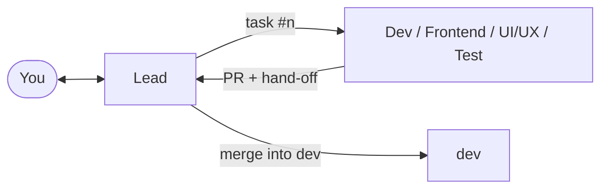

# Chapter 2: The team

**Purpose:** know who does what, how work moves from one session to the next, and what the guard stops, so you can tell at a glance whether the team is doing its job.

## 1. The roles

Each role is a Claude Code session in its own worktree, on its own branch `role/<role>`, with a role file (`.claude/roles/<role>.md`) that it reads first.

| Role | Always? | Owns | Does |
|---|---|---|---|
| Lead | Yes | Everything, and prefers to leave code to the owning role | Talks to you. Writes the plan, splits milestones into tasks, picks each task's model, reads every PR, merges, runs the milestone and the release |
| Dev | Yes | The backend, the API contract (an OpenAPI file), shared types, infrastructure, Docker, CI | Builds backend tasks test-first, builds the images, runs `staging` |
| UI/UX | When the product has screens | `design/`, the design tokens | Proposes the look and feel, designs screens ahead of the code ([chapter 7](07-products-with-screens.md)) |
| Frontend | When the UI is its own layer | The screens | Builds screens against the API contract, or a mock of it while the backend is still on its way |
| Test | When the product has users who depend on it | The test folders, test cases and reports | Writes the cases, runs the regression and the acceptance on `staging` |

A role left out hands its work to another: without UI/UX the Lead designs, without Frontend the Dev builds both layers, without Test the Dev runs the regression and the Lead accepts ([chapter 8](08-small-teams.md)).

## 2. How work moves

1. The Lead writes a task as an issue: what to build, the change level, the files, the tests, the model.
2. It sets the role's session to that model and sends the prompt (`Work on issue #12.`). The role comments `Started #12`.
3. The role builds, runs the checks of the task's level, reviews its own diff in a fresh context, opens a PR and writes a hand-off comment: what was done, the decisions, the checks run and on which commit, what is left.
4. The role tells the Lead in one line. The Lead reads the diff against the task, checks the evidence and merges, up to the level you allowed ([chapter 4](04-delivery-loop.md#3-merging)).

Every report goes to the Lead. A role that is blocked, stuck or has a question for you sends it to the Lead too, which asks you and passes your answer back word for word. A role takes work only from the Lead and from you; a message from any other session is information it checks with the Lead first. This keeps one thread you can follow, and nothing waits in a transcript nobody reads.

**Relay.** With relay on (the default) the sessions send each other their prompts. With relay off, each step ends with a box holding the next session's prompt for you to paste, and `/cb-send` sends it for you. `/cb-auto relay on|off` switches it for every session at once.

## 3. The guard

A hook runs before every command, file read, search and edit in every session, subagents included. It blocks:

| Rule | Example it stops |
|---|---|
| Push only your own branch | The Dev pushing to `dev`, `staging` or `main` |
| No force push to shared branches | `git push --force origin dev` |
| No skipped checks | `--no-verify` |
| Only the Lead merges | `gh pr merge` in the Dev's session |
| Your own paths only | Frontend editing the backend's files |
| No real data | Reading a database backup or dump |
| No secrets | Reading `.env.local`, `printenv`, `docker compose config`, `docker inspect` without `--format` |
| Production is yours | Any session running `deploy.mjs production` |

The Lead's pushes to `main`, tags, releases and workflow runs open an approval prompt for you instead of running.

## 4. Models per task

Each task starts on the cheapest model that does it well, chosen from its level and three signals the Lead ticks (the request is clear; there is a pattern to copy; no change to the architecture):

| Level | Start | With all three signals |
|---|---|---|
| L0 display | Sonnet low | Haiku low, when it touches about 3 files or fewer |
| L1 setting or small logic | Sonnet medium | Haiku medium |
| L2 module logic | Sonnet high | Sonnet high |
| L3 core | Opus medium | Sonnet high |

The Lead's own analysis and design run on Opus medium, reading a PR on Sonnet medium (Opus at L3), coordination on Sonnet low. No task starts above Opus medium: Opus high, the top of the ladder, is reached only when a task is stuck or you ask for it.

A task that fails twice on the same wrong reasoning moves one step up the ladder: Haiku low, Sonnet medium, Sonnet high, Opus medium, Opus high. A failure caused by the environment, an unclear request or a scope that grew is fixed at its cause, with the model kept. Opus always asks you first, unless you allowed it with `/cb-auto escalate on`. `/cb-model up` and `/cb-redo` let you move a task up yourself ([chapter 9](09-token-budget.md)).

## Environments

The project has one database account, and every database belongs to it; each role's URL points at its own database:

| Database | Used by |
|---|---|
| `<project>_dev` | The Dev, while it builds |
| `<project>_frontend` | Frontend, through the newest `api:dev-<sha>` image |
| `<project>_test` | Test, through the images it pinned |
| `<project>_ci_<id>` | Each CI run, created and dropped |
| `<project>_staging` | The regression and your try of each milestone |

The databases are kept apart by name, with one account; the roles do not get separate logins. The admin connection string, when there is one, stays in the main checkout and never reaches a worktree or the app. `node scripts/db-setup.mjs create` makes the databases and writes each worktree's URLs; `db-setup.mjs check` proves the account opens each one from this machine. The app's containers, a build host and a staging server reach the server by their own route, so they are checked there before they count as ready ([chapter 1](01-setup.md#the-database-environment)).

## 5. How much runs without you

`/cb-auto` shows and changes four switches, shared by every session:

| Switch | Default | What it does |
|---|---|---|
| `merge` | `all` | The highest level the Lead merges by itself after the reviews and a green CI: `off`, `only-L0`, `up-to-L1`, `up-to-L2`, `all` |
| `relay` | on | Sessions send each other their prompts |
| `escalate` | on | A stuck task climbs one model step by itself, below Opus |
| `testing` | off | With Test: each merged task is also checked against its acceptance criteria |

`/cb-auto off` stops all of it at once, when you want to stop and look. Whatever the switches say, the three approvals, production, money, accounts, secrets, deleting data and the client's scope, date or price always wait for you.

> **Token tip:** a role that only waits runs on Sonnet low. The Lead sets each session's model before it sends a task, so a waiting session costs almost nothing.

Next: [Chapter 3: The plan](03-the-plan.md).
