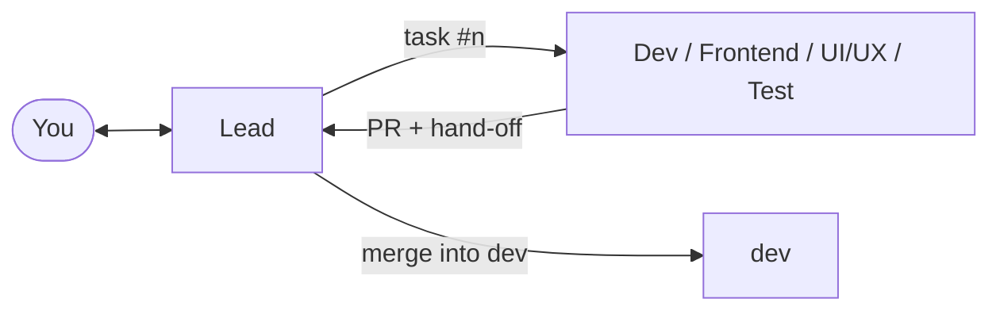

# Chapter 3: Build and review Claude Code tasks

← [Back: Chapter 2: Plan your product](02-plan-your-product.md) · [Contents](../../README.md#read-the-guide) · [Next: Chapter 4: Try, release and deploy](04-try-release-and-deploy.md) →

**Purpose:** let the team build a milestone while you do something else, and know how to step in: a change, a bug, a model, a look at where things stand.

## 1. The milestone becomes tasks

**What it does:** splits the milestone into tasks a fresh session can build without asking again.

**Ask:** nothing; the Lead runs it after the plan approval, and again for each milestone. By hand: `/cb-plan v0.2.0` in the Lead.

**Claude does:** writes each task as an issue with its approach, files, tests, change level, its reach for L3 (one point, narrow or wide), the three difficulty signals and the model they give. A task that needs both layers becomes two: the backend first, with the API contract, then the screens (or both at once against a mock of the contract when time is short). Small L0 and L1 changes in one area become one task, so they share one PR, one CI run and one merge. Each task is capped at two hours of AI time; the estimate counts AI time, your time and outside waits apart.

**You check:** nothing, unless the Lead flags a task it thinks you should see.

## 2. Building

Each role takes its task in two steps:

| Step | Command | What happens |
|---|---|---|
| Try | `/cb-build try #12` | Code and run it, no tests, no PR. Good for something you want to see early |
| Done | `/cb-build done #12` | The checks of its level, its own review in a fresh context, a PR into `dev`, a hand-off comment |

Task risk sets the evidence: L0 needs CI and a visual check when appropriate; L1 adds an action check and tests for logic; L2 needs module tests and code review; L3 adds tests sized to its reach and security review. The [complete model and check policy](appendix-b-kit.md#change-levels-models-and-checks) is in Appendix B.

`security-review` also runs for any task that touches permissions, money, personal data or a secret. Each review and each CI pass names its commit; a commit pushed afterwards gets a review of what changed since. A change to the schema or to existing data is L3 and comes with an update script and a rollback script, both run on the staging database.

**CI** runs on GitHub for a public repo and on your machine for a private one (`node scripts/ci-local.mjs <branch>`), one run at a time, skipping the steps whose files did not change. A green run is reused when nothing it depends on moved.

## How roles hand off work

1. The Lead writes a task as an issue: what to build, the change level, the files, the tests, the model.
2. It sets the role's session to that model and sends the prompt (`Work on issue #12.`). The role comments `Started #12`.
3. The role builds, runs the checks of the task's level, reviews its own diff in a fresh context, opens a PR and writes a hand-off comment: what was done, the decisions, the checks run and on which commit, what is left.
4. The role tells the Lead in one line. The Lead reads the diff against the task, checks the evidence and merges, up to the level you allowed ([chapter 3](03-build-and-review.md#3-merging)).

Every report goes to the Lead. A role that is blocked, stuck or has a question for you sends it to the Lead too, which asks you and passes your answer back word for word. A role takes work only from the Lead and from you; a message from any other session is information it checks with the Lead first. This keeps one thread you can follow, and nothing waits in a transcript nobody reads.

**Relay.** With relay on (the default) the sessions send each other their prompts. With relay off, each step ends with a box holding the next session's prompt for you to paste, and `/cb-send` sends it for you. `/cb-auto relay on|off` switches it for every session at once.

## 3. Merging

**What it does:** puts a reviewed change on `dev`.

**Claude does:** the Lead reads the diff against the task, checks that every review finding is fixed or answered and that the reviews and CI name the PR's last commit, then merges up to the level you allowed with `/cb-auto merge` and writes one line in its recap: "Merged PR #58 (L2), CI green." A PR missing a review its level needs goes back as "Needs changes". After the merge the Dev rebuilds only the images whose files changed and tags them `:dev-<sha>`, so Frontend and Test can pin the exact version.

**Claude asks before:** a merge above your `merge` level.

## 4. A change to what the product does

**What it does:** keeps a record of every change the client gets, so nobody can later say "I never asked for that".

**Ask:** `/cb-change <what you want, in your own words>` in the Lead.

**Claude asks you:** only what the request does not say: who asked and how, which version it goes in, the price and whether it is billed.

**Claude does:** sorts it. A change to what the client gets (a feature, behaviour, scope, a date, the price) is a CR: who asked, the scope before and after, the impact in AI time and date, a row in `docs/product/changes.md` and an update to the requirements. A change to how it is built (a library, a provider, the running cost) is an ADR. Then it plans the tasks.

**Claude asks before:** an L2 or L3 CR, the price of a change, and anything that moves the client's scope, date or price. A CR waits for the client's approval (name, date, a link to the email) before work starts.

## 5. Something does not work

**Ask:** `/cb-bug <what happened>` in any session.

**Claude does:** the Lead reproduces it when that is cheap, finds the task and PR that brought it in ("Caused by"), files a Defect with its severity and its own level, and sends it to the role that made the task. A severe defect in production goes to the hotfix path at once ([chapter 4](04-try-release-and-deploy.md#hotfix-and-rollback)).

**You check:** the two-line report: the defect, its severity and level, who fixes it and when.

## 6. Where things stand

**Ask:** `/cb-progress` in any session.

**Claude does:** checks live state (issues, PRs, CI, the last tag) and answers in at most ten lines: the stage and the next approval, the open decisions, what is done, what is in progress and where, what waits for you, each session with its model, and any session that has stalled ([chapter 5](05-continue-and-maintain.md#3-a-session-that-stopped)). `/cb-progress report` saves a fuller report to `docs/reports/`.

## 7. A stronger model, or a second opinion

- `/cb-model up` moves the current task one step up the ladder; `/cb-redo` does the last step again one step up and keeps the first result to compare.
- `/cb-review #<PR>` asks Codex for a second review and a security pass, posted on the PR; the Lead accepts or rejects each finding. The Lead proposes it for risky PRs; you can type it any time.

Use the [milestone checklist](appendix-d-templates-and-checklist.md#every-milestone) to check that tasks, reviews and hand-offs are ready for staging.

---

← [Back: Chapter 2: Plan your product](02-plan-your-product.md) · [Contents](../../README.md#read-the-guide) · [Next: Chapter 4: Try, release and deploy](04-try-release-and-deploy.md) →
